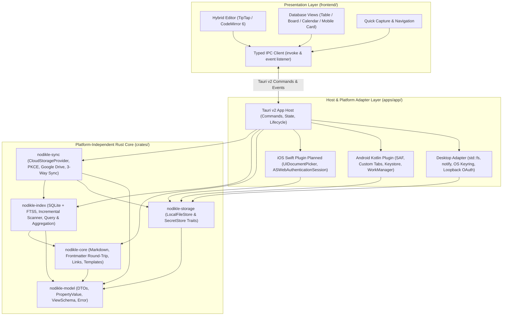

# 01. 전체 시스템 아키텍처 및 크로스플랫폼 UI 전략

## 1. 설계 목표 및 정량적 성능 기준

**Nodikle**는 로컬 우선(Local-first) Markdown 지식 관리의 가벼움과 구조화된 블록 문서·데이터베이스 뷰의 생산성을 결합한 크로스플랫폼 문서 관리 프로그램입니다.

### 핵심 설계 원칙
1. **Local-first & Open Format:** 모든 문서와 데이터베이스 레코드의 단일 원본(Source of Truth)은 벤더 비종속 순수 Markdown(`.md`) + YAML Frontmatter 파일입니다. 오프라인 환경에서도 읽기·편집·검색·집계가 100% 동작합니다.
2. **단일 Rust 코어 재사용:** 파일 파싱, 위키링크·태그 추출, SQLite FTS5 인덱싱, 필터·정렬·집계 쿼리, 클라우드 동기화 엔진은 플랫폼 비의존 Rust 크레이트(`crates/`)로 작성하여 Desktop(Windows/macOS/Linux), Android, 추후 iOS에서 동일하게 재사용합니다.
3. **경량 실행 Footprint:** 데스크톱과 모바일 모두에서 빠른 기동과 낮은 메모리 점유율을 유지합니다.

### 정량적 성능 목표 (Target SLO)
| 항목 | 목표 수치 | 측정 기준 |
|---|---|---|
| Desktop 콜드 스타트 | `< 500 ms` | 창 표시 및 최근 Vault 인덱스 오픈까지 |
| 유휴 메모리 점유율 | `< 100 MB` | Desktop 기준 문서 1,000건 Vault 로드 후 |
| 증분 인덱스 스캔 | `< 300 ms` | 10,000건 Vault 기준 변경분 10건 이하 스캔 |
| 전문 검색 (FTS5) | `< 30 ms` | 10,000건 문서 기준 상위 50건 스니펫 반환 |
| 데이터베이스 뷰 쿼리 | `< 50 ms` | 1,000행 필터·정렬·그룹 집계(`SUM`/`COUNT`) |

---

## 2. 크로스플랫폼 UI 스택 비교 및 선정

Desktop + Android(및 추후 iOS)를 단일 UI 코드베이스로 커버하면서 블록 기반 리치 에디터, 다중 뷰(테이블·칸반·캘린더), 모바일 터치 UX, 한글 IME를 안정적으로 구현하기 위해 3가지 스택을 비교했습니다.

| 평가 항목 | Tauri v2 + 경량 웹 프론트엔드 (React/TS) | Flutter + `flutter_rust_bridge` | Dioxus (Rust Full-Stack UI) |
|---|---|---|---|
| **타깃 플랫폼 지원** | Desktop(Win/macOS/Linux) + Android + iOS 공식 지원 | Desktop + Android + iOS 공식 지원 | Desktop + Mobile 지원 (모바일·웹뷰 호스팅 성숙도 진행 중) |
| **바이너리 크기 & 메모리** | OS 내장 WebView(WebView2 / WKWebView / Android WebView) 재사용으로 매우 경량 | Skia/Impeller 그래픽 엔진 내장으로 바이너리·상시 메모리 증가 | 매우 경량이나 플랫폼별 WebView/WGPU 편차 존재 |
| **블록 에디터 & DB 뷰 생태계** | **최상.** TipTap(ProseMirror), CodeMirror 6, TanStack Table 등 검증된 생태계 활용 | 리치 블록 에디터·복합 테이블 위젯 성숙도가 낮아 자체 구현 비중 높음 | 리치 블록 에디터·드래그 칸반·캘린더 컴포넌트 생태계 부족 |
| **한글 IME & 클립보드** | 브라우저 엔진 기반의 성숙한 조합 입력(IME)·드래그·복사/붙여넣기 | 데스크톱·모바일 IME 에지 케이스 대응에 추가 공수 필요 | 플랫폼별 IME 및 복합 입력 제어 직접 구현 필요 |
| **Rust 코어 통합** | Tauri Commands / Events / Binary Channel로 Rust 코어 직접 호출 | FFI 코드 생성 계층(`flutter_rust_bridge`) 상시 유지 필요 | FFI 불필요하나 UI 컴포넌트 구축 비용이 매우 높음 |
| **모바일 네이티브 브릿지** | Tauri v2 Kotlin(Android) / Swift(iOS) 플러그인으로 SAF·Custom Tabs·Keystore 연동 | Dart MethodChannel / Pigeon 생태계 성숙 | 모바일 시스템 API 바인딩 직접 작성 필요 |

### 최종 추천: **Tauri v2 + 경량 웹 프론트엔드 (TypeScript + React + TipTap / CodeMirror 6)**

**선정 근거:**
1. **블록 편집과 원문 Markdown 편집의 공존:** ProseMirror 기반의 **TipTap**(블록 에디터, 슬래시 `/` 커맨드, 드래그 핸들)과 **CodeMirror 6**(원문 Markdown 편집, `[[` 자동완성, 모바일 터치 스크롤)을 단일 문서 모델 위에서 매끄럽게 전환할 수 있습니다.
2. **가벼운 리소스 사용:** OS 기본 WebView를 사용하므로 별도 브라우저 런타임을 번들링하지 않아 바이너리 크기와 메모리 점유율이 낮습니다.
3. **Rust 코어 직접 링크:** `apps/app`이 `nodikle-core`, `nodikle-index`, `nodikle-storage`, `nodikle-sync`를 직접 링크하므로 별도 로컬 HTTP 서버 없이 타입 안전한 IPC를 구현할 수 있습니다.
4. **모바일 시스템 API 격리:** Android SAF, Chrome Custom Tabs OAuth Deep Link, `WorkManager`, Android Keystore는 Tauri v2 Kotlin 플러그인으로 캡슐화하여 코어 크레이트를 순수하게 유지할 수 있습니다.

---

## 3. 레이어드 아키텍처 & 크레이트 의존성 DAG

의존성은 반드시 **Presentation → Host/Adapter → Core Engine → Model** 단방향으로만 흐르며, 크레이트 간 순환 의존성은 컴파일 단계에서 금지합니다.



---

## 4. Cargo Workspace 크레이트 및 내부 모듈 구조

```text
crates/
├── nodikle-model/              # 공용 도메인 모델 & 직렬화 규약
│   └── src/
│       ├── lib.rs
│       ├── document.rs         # DocumentId, DocumentMeta, ParsedDocument, TaskItem
│       ├── property.rs         # PropertyType, PropertyValue, PropertySchema
│       ├── view.rs             # ViewSchema, FilterExpr, SortSpec, AggregationOp
│       ├── sync.rs             # SyncStateRecord, ConflictInfo, SyncProgress
│       └── error.rs            # NodikleError, ErrorCode
├── nodikle-core/               # 순수 문서 파싱, 패치, 템플릿 엔진
│   └── src/
│       ├── parser.rs           # pulldown-cmark 기반 본문/체크리스트/헤딩 파서
│       ├── frontmatter.rs      # YAML 분리 및 본문·주석 보존형 Round-Trip 업데이터
│       ├── wikilink.rs         # [[target|alias#heading]] 추출 및 경로 우선순위 해석
│       ├── tag.rs              # 중첩 태그(#a/b) 정규화 및 중복 제거
│       └── template.rs         # {{date}}, {{title}}, {{uuid}} 치환 및 Frontmatter 바인딩
├── nodikle-index/              # SQLite + FTS5 로컬 인덱스 & 쿼리 빌더
│   └── src/
│       ├── migrations.rs       # 스키마 버전 관리 및 DDL 마이그레이션
│       ├── scanner.rs          # mtime/size/BLAKE3 기반 증분 스캐너
│       ├── fts.rs              # FTS5(trigram) 검색 및 초단문(<3자) LIKE 폴백
│       ├── graph.rs            # 백링크, 미생성 링크, 로컬 그래프 질의
│       └── query.rs            # ViewSchema Filter/Sort/Group/Aggregation SQL 빌더
├── nodikle-storage/            # 저장소/시크릿 추상화 & 플랫폼 구현체
│   └── src/
│       ├── traits.rs           # LocalFileStore, SecretStore 트레이트
│       ├── atomic.rs           # Path Traversal 차단 & 원자적 쓰기 검증 유틸
│       ├── fs_desktop.rs       # Desktop std::fs/tokio::fs + keyring 구현
│       └── bridge_mobile.rs    # Android SAF / Keystore 콜백 브릿지 어댑터
└── nodikle-sync/               # 클라우드 동기화 & OAuth PKCE 엔진
    └── src/
        ├── provider.rs         # CloudStorageProvider 트레이트 & Provider Registry
        ├── pkce.rs             # OAuth 2.0 PKCE(S256) 상태 머신 & Single-Flight Refresh
        ├── gdrive.rs           # Google Drive API v3 (drive.file, changes.list, resumable)
        ├── engine.rs           # 3-Way 변경 감지 판정 & 동기화 오케스트레이터
        ├── conflict.rs         # .conflict-<device>-<ts>.md 생성 & 해소 핸들러
        └── queue.rs            # 오프라인 영속 큐, 지수 백오프, 네트워크 정책 필터
```

---

## 5. 프론트엔드-코어 IPC 인터페이스 계약

프론트엔드는 파일 시스템이나 SQLite에 직접 접근하지 않고, Tauri v2의 타입 안전 커맨드와 이벤트 스트림을 통해서만 코어를 호출합니다.

### 5.1 Request / Response Commands (`invoke`)
| Command 이름 | 입력 DTO (요약) | 반환 DTO (요약) | 담당 크레이트 |
|---|---|---|---|
| `vault_open` | `{ vault_path, mode }` | `{ vault_id, doc_count, sync_enabled }` | `storage` + `index` |
| `vault_reindex` | `{ full_rebuild: bool }` | `{ scanned, updated, removed, elapsed_ms }` | `index` |
| `doc_get` | `{ rel_path }` | `{ meta, frontmatter, body_md, backlinks, tasks }` | `storage` + `core` + `index` |
| `doc_save` | `{ rel_path, raw_md, expected_hash? }` | `{ new_hash, updated_at }` | `storage` + `core` + `index` |
| `doc_patch_properties` | `{ rel_path, patches: PropertyPatch[] }` | `{ new_hash, updated_props }` | `core` + `storage` + `index` |
| `doc_toggle_task` | `{ rel_path, line_no, completed }` | `{ new_hash }` | `core` + `storage` + `index` |
| `doc_create_from_template` | `{ view_id?, template_path, title, props }` | `{ rel_path, meta }` | `core` + `storage` + `index` |
| `view_query` | `{ view_id, runtime_filter?, page, limit }` | `{ rows, groups, aggregations, total_count }` | `index` |
| `search_fts` | `{ query, tag_prefix?, folder?, limit }` | `{ hits: SearchHit[] }` | `index` |
| `auth_start_oauth` | `{ provider_id }` | `{ account_email, scope }` | `sync` |
| `sync_trigger` | `{ reason: Manual \| Debounce \| Foreground }` | `{ pushed, pulled, conflicts }` | `sync` |
| `sync_resolve_conflict` | `{ conflict_id, strategy }` | `{ resolved_path }` | `sync` |

### 5.2 Core → UI Server-Push Events (`emit`)
| Event 이름 | 페이로드 | UI 동작 |
|---|---|---|
| `vault:file_changed` | `{ rel_paths: string[] }` | 현재 열려 있는 문서/뷰가 해당 경로를 포함하면 부분 리프레시 |
| `index:progress` | `{ processed, total }` | 초기 대규모 Vault 스캔 시 상단 진행률 바 표시 |
| `sync:status_changed` | `{ state: Idle \| Syncing \| Offline \| Error, pending_count }` | 상태 바 동기화 아이콘 및 대기 건수 갱신 |
| `sync:conflict_detected` | `{ conflict_id, original_path, conflict_path }` | 상단 충돌 알림 배너 및 Diff 병합 모달 진입 버튼 노출 |

---

## 6. 동시성 모델 및 에러 체계

### 6.1 동시성 및 스레드 격리
- **Async I/O vs Blocking 분리:** 네트워크 통신(`reqwest`)과 동기화 오케스트레이션은 `tokio` 비동기 태스크에서 실행하고, SQLite(`rusqlite`) 쿼리와 대량 파일 해시 계산(`BLAKE3`)은 `tokio::task::spawn_blocking` 전용 풀에서 처리해 UI/IPC 이벤트 루프 블로킹을 방지합니다.
- **SQLite Single-Writer / Multi-Reader:** SQLite WAL(`journal_mode = WAL`)을 활성화해 다수의 뷰 조회·검색 쿼리가 쓰기 작업과 경합하지 않도록 하며, 쓰기 작업(인덱스 갱신·동기화 상태 기록)은 단일 직렬화 Writer 채널을 통해 `SQLITE_BUSY` 경합을 원천 차단합니다.
- **자체 쓰기 에코 억제 (Write Echo Suppression):** 앱 내부 `doc_save` / `doc_patch_properties` 실행 시 `(rel_path, blake3_hash, timestamp)`를 단기 메모리 캐시(TTL 1초)에 등록하여, Desktop 파일 워처(`notify`)가 방금 자신이 저장한 파일 이벤트를 중복 재인덱싱하지 않도록 합니다.

### 6.2 에러 분류 및 전파 규약 (`NodikleError`)
| ErrorCode | 발생 계층 | 원인 | 프론트엔드 처리 규약 |
|---|---|---|---|
| `ERR_INVALID_PATH` | `storage` | Vault 루트 탈출(`..`) 또는 잘못된 경로 | 저장 차단 및 경로 오류 토스트 표시 |
| `ERR_INVALID_FRONTMATTER` | `core` | 손상된 YAML 구문 | 원문 Markdown 모드로 폴백 오픈 및 문법 오류 위치 안내 |
| `ERR_OPTIMISTIC_LOCK` | `storage` | `expected_hash` 불일치(외부/원격에서 먼저 수정됨) | 자동 덮어쓰기 중단 후 최신본 비교/병합 유도 |
| `ERR_STORAGE_PERMISSION` | `storage` | Android SAF 권한 만료 또는 디스크 읽기 전용 | 권한 재승인(`ACTION_OPEN_DOCUMENT_TREE`) 다이얼로그 유도 |
| `ERR_AUTH_EXPIRED` | `sync` | OAuth Refresh Token 만료 또는 취소 | 오프라인 모드 유지 + 재로그인 배너 표시 |
| `ERR_NETWORK_OFFLINE` | `sync` | 오프라인 상태 또는 DNS/TLS 실패 | 로컬 저장은 정상 완료, `sync_queue`에 보류 |
| `ERR_RATE_LIMITED` | `sync` | 원격 API `429`/`503` 응답 | `Retry-After` 기반 백오프 스케줄링 |

---

## 7. 플랫폼별 호스트 어댑터 매트릭스

| 기능 영역 | Desktop (`Windows` / `macOS` / `Linux`) | Android (MVP) | iOS (추후 확장) |
|---|---|---|---|
| **로컬 파일 I/O** | `std::fs` + `tokio::fs` 직접 접근 | 앱 전용 저장소(`filesDir`) 기본 + SAF(`ContentResolver`) 옵션 | 앱 컨테이너 + `UIDocumentPickerViewController` (Security-Scoped) |
| **SQLite 위치** | `<Vault>/.nodikle/index.db` | 앱 내부 전용 `filesDir/db/<vault_id>.db` (고정) | 앱 내부 `Library/Application Support/db/` (고정) |
| **변경 감지** | `notify` 실시간 파일 워처 (150ms 디바운스) | 앱 저장 즉시 갱신 + 포그라운드 복귀 증분 스캔 | 앱 저장 즉시 갱신 + 포그라운드 복귀 증분 스캔 |
| **시크릿/토큰 저장** | OS Keyring (Credential Manager / Keychain / Secret Service) | Android Keystore + `EncryptedSharedPreferences` | iOS Keychain (`SecItem`) |
| **OAuth 2.0 PKCE** | 시스템 브라우저 + `127.0.0.1:<port>` 루프백 | Chrome Custom Tabs + `nodikle://oauth/callback` Deep Link | `ASWebAuthenticationSession` |
| **백그라운드 동기화** | 앱 실행 중 디바운스 + 주기 타이머 | `WorkManager` (네트워크 연결 + 배터리 여유 시) | `BGAppRefreshTask` |
