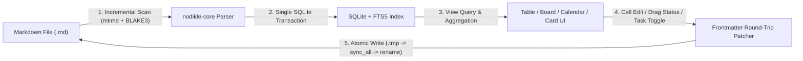

# 02. 하이브리드 문서·데이터 모델 및 데이터베이스 뷰 설계

## 1. Vault 디렉토리 규약 및 파일 포맷 명세

Nodikle의 모든 사용자 데이터는 **UTF-8 인코딩, LF(`\n`) 줄바꿈으로 정규화된 일반 Markdown(`.md`) 파일**을 단일 원본(Source of Truth)으로 삼습니다.

```text
VaultRoot/
├── .nodikle/
│   ├── views/                  # 데이터베이스 뷰 스키마 (*.yaml)
│   │   ├── expenses.yaml       # 가계부 뷰 정의
│   │   └── trips.yaml          # 여행 플래너 뷰 정의
│   ├── workspace.json          # 최근 열린 문서·UI 상태 (기기별 로컬/선택 동기화)
│   └── index.db                # 파생 SQLite 인덱스 (Desktop 전용 위치, 동기화 제외)
├── _templates/                 # 재사용 가능한 문서 템플릿
│   ├── expense-entry.md
│   └── trip-plan.md
├── attachments/                # 이미지, PDF 등 바이너리 첨부 파일
│   └── 2026/11/a1b2c3d4-receipt.jpg
├── finance/                    # 가계부 문서 컬렉션
│   ├── 2026-11-27-lunch.md
│   └── 2026-11-27-subway.md
├── trips/                      # 여행 플래너 문서 컬렉션
│   └── 2026-12-kyoto.md
└── notes/                      # 일반 지식 노트
    └── local-first-design.md
```

### Frontmatter 시스템 예약 키 vs 사용자 속성
| 키 이름 | 필수 여부 | 설명 |
|---|---|---|
| `id` | 선택 (자동 부여 가능) | UUID v7 기반 안정적 문서 식별자 (파일명 변경 시에도 관계 유지) |
| `type` | 선택 | 문서/컬렉션 유형 식별자 (예: `expense`, `trip`, `note`) |
| `title` | 선택 | 미지정 시 첫 번째 H1(`# 제목`) 또는 파일명(Stem)을 제목으로 인덱싱 |
| `tags` | 선택 | 문자열 또는 문자열 배열. 본문 인라인 `#태그`와 통합 인덱싱 |
| `created_at` / `updated_at` | 선택 | ISO-8601 타임스탬프 (미지정 시 파일 메타데이터 기준 보완) |
| 기타 사용자 정의 키 | 자유 | `amount`, `category`, `date`, `status`, `budget` 등 DB 뷰에서 속성으로 사용 |

### 첨부 파일 저장 규약
- 첨부 파일 추가 시 SHA-256/BLAKE3 앞 8자리 해시 접두사를 붙여 충돌을 방지하고 월별 디렉토리에 저장합니다:
  `attachments/YYYY/MM/<hash8>-<sanitized_filename>`
- 본문에서는 Vault 루트 기준 상대 경로(`![[attachments/2026/11/a1b2c3d4-receipt.jpg]]` 또는 표준 Markdown ``)로 참조해 어느 OS로 복사해도 깨지지 않습니다.

---

## 2. Markdown 지식 연결 & 파싱 명세

### 2.1 양방향 링크 (`[[Wikilink]]`) 문법 및 해석 우선순위
`nodikle-core`는 `pulldown-cmark` 이벤트 스트림을 순회하며 **코드 펜스(```` ``` ````)와 인라인 코드(`` `...` ``) 바깥 영역**에서만 아래 문법을 추출합니다.

- 기본 링크: `[[local-first-design]]`
- 별칭 링크: `[[2026-12-kyoto|교토 겨울 여행]]`
- 섹션/헤딩 링크: `[[2026-12-kyoto#예산 요약]]`
- 파일 임베드: `![[attachments/2026/11/a1b2c3d4-receipt.jpg]]`

**대상 문서 매칭 우선순위:**
1. Vault 루트 기준 정확히 일치하는 상대 경로 (`.md` 생략 허용): `trips/2026-12-kyoto`
2. Vault 전체에서 유일한 파일명(Stem)과 일치하는 문서
3. 대소문자 무시(Case-insensitive) 파일명 매칭
4. 매칭 실패 시 `target_doc_id = NULL`, `raw_target = '<입력값>'`으로 저장하여 **미생성 링크(Unresolved Link)**로 표시하고 클릭 시 즉시 문서를 생성할 수 있게 합니다.

**파일 이름 변경 시 링크 무결성:** 문서 경로 또는 파일명 변경 시 SQLite `links` 테이블에서 해당 문서를 가리키는 모든 `source_doc_id`를 조회해 링크 문자열을 일괄 갱신할 수 있는 옵션을 제공합니다.

### 2.2 중첩 태그 (Nested Tags)
- Frontmatter `tags`와 본문 인라인 태그(`(?<![^\s(\[])#([A-Za-z0-9가-힣_-]+(?:/[A-Za-z0-9가-힣_-]+)*)`)를 모두 추출해 소문자/NFC 정규화 후 `tags` 테이블에 저장합니다.
- `#가계부/식비` 인덱싱 시 상위 경로 조회(`tag = '가계부' OR tag LIKE '가계부/%'`)로 계층 필터링을 지원합니다.

### 2.3 체크리스트 (`TaskItem`) 추출
- Markdown 리스트 태스크 `- [ ] ...` 및 `- [x] ...`를 라인 번호(`line_no`)와 함께 `tasks` 테이블에 인덱싱합니다.
- 데이터베이스 뷰(예: 여행 플래너)에서 별도 속성으로 중복 기록하지 않아도 해당 문서의 `완료 태스크 수 / 전체 태스크 수` 진행률을 자동 계산할 수 있습니다.

---

## 3. SQLite 로컬 인덱스 DDL & FTS5 검색 설계

SQLite 연결 초기화 시 아래 PRAGMA를 항상 적용합니다.

```sql
PRAGMA journal_mode = WAL;
PRAGMA synchronous = NORMAL;
PRAGMA foreign_keys = ON;
PRAGMA temp_store = MEMORY;
PRAGMA busy_timeout = 5000;
```

### 3.1 핵심 테이블 DDL
```sql
CREATE TABLE IF NOT EXISTS documents (
    id            TEXT PRIMARY KEY,
    rel_path      TEXT NOT NULL UNIQUE,
    stem          TEXT NOT NULL,
    folder        TEXT NOT NULL,
    title         TEXT NOT NULL,
    doc_type      TEXT,
    content_hash  TEXT NOT NULL,          -- BLAKE3 hex
    mtime_ms      INTEGER NOT NULL,
    size_bytes    INTEGER NOT NULL,
    created_at    TEXT NOT NULL,
    updated_at    TEXT NOT NULL
);

CREATE INDEX IF NOT EXISTS idx_documents_folder ON documents(folder);
CREATE INDEX IF NOT EXISTS idx_documents_type ON documents(doc_type);
CREATE INDEX IF NOT EXISTS idx_documents_stem ON documents(stem);

CREATE TABLE IF NOT EXISTS properties (
    doc_id        TEXT NOT NULL REFERENCES documents(id) ON DELETE CASCADE,
    key           TEXT NOT NULL,
    ordinal       INTEGER NOT NULL DEFAULT 0, -- multi_select 배열 순서
    value_type    TEXT NOT NULL,              -- text|number|date|bool
    val_text      TEXT,
    val_num       REAL,
    val_date      TEXT,                       -- ISO-8601 (YYYY-MM-DD or full)
    val_bool      INTEGER,                    -- 0 or 1
    PRIMARY KEY (doc_id, key, ordinal)
);

CREATE INDEX IF NOT EXISTS idx_props_key_text ON properties(key, val_text);
CREATE INDEX IF NOT EXISTS idx_props_key_num  ON properties(key, val_num);
CREATE INDEX IF NOT EXISTS idx_props_key_date ON properties(key, val_date);

CREATE TABLE IF NOT EXISTS links (
    id            INTEGER PRIMARY KEY AUTOINCREMENT,
    source_doc_id TEXT NOT NULL REFERENCES documents(id) ON DELETE CASCADE,
    target_doc_id TEXT REFERENCES documents(id) ON DELETE SET NULL,
    raw_target    TEXT NOT NULL,
    anchor        TEXT,
    alias         TEXT,
    is_embed      INTEGER NOT NULL DEFAULT 0
);

CREATE INDEX IF NOT EXISTS idx_links_source ON links(source_doc_id);
CREATE INDEX IF NOT EXISTS idx_links_target ON links(target_doc_id);
CREATE INDEX IF NOT EXISTS idx_links_raw    ON links(raw_target);

CREATE TABLE IF NOT EXISTS tags (
    doc_id        TEXT NOT NULL REFERENCES documents(id) ON DELETE CASCADE,
    tag           TEXT NOT NULL,
    PRIMARY KEY (doc_id, tag)
);

CREATE INDEX IF NOT EXISTS idx_tags_tag ON tags(tag);

CREATE TABLE IF NOT EXISTS tasks (
    doc_id        TEXT NOT NULL REFERENCES documents(id) ON DELETE CASCADE,
    line_no       INTEGER NOT NULL,
    completed     INTEGER NOT NULL,
    body          TEXT NOT NULL,
    PRIMARY KEY (doc_id, line_no)
);

CREATE VIRTUAL TABLE IF NOT EXISTS fts_documents USING fts5(
    doc_id UNINDEXED,
    title,
    body_plain,
    tokenize = 'trigram'
);
```

### 3.2 한글/CJK 대응 전문 검색 전략
- **3글자 이상 질의:** `fts_documents MATCH ?` (`trigram` 토크나이저)를 사용하여 띄어쓰기 변형이나 조사 결합이 있는 한국어 문장에서도 고속 부분 일치 및 `snippet(fts_documents, 2, '<mark>', '</mark>', '...', 24)` 하이라이팅을 제공합니다.
- **1~2글자 초단문 질의:** `trigram` 인덱스는 3-gram 미만을 매칭하지 못하므로, 검색어 길이가 3문자 미만일 때는 자동으로 `documents.title LIKE '%q%' OR fts_documents.body_plain LIKE '%q%'` 파라미터 바인딩 쿼리로 폴백합니다.

---

## 4. 속성 기반 데이터베이스 뷰 스키마 & 쿼리 파이프라인

### 4.1 Filter AST & Aggregation 규약
뷰 스키마(`.nodikle/views/*.yaml`)와 런타임 UI 필터는 공통 `FilterExpr` AST로 표현되며, `nodikle-index`가 SQL 인젝션을 방지하는 **바인딩 파라미터 SQL**로 컴파일합니다.

- **비교 연산자:** `eq`, `neq`, `gt`, `gte`, `lt`, `lte`, `contains`, `starts_with`, `in`, `between`, `is_empty`, `is_not_empty`
- **논리 조합:** `and(Vec<FilterExpr>)`, `or(Vec<FilterExpr>)`, `not(Box<FilterExpr>)`
- **지원 집계 (`AggregationOp`):**
  - `count`: 필터된 행 수
  - `sum(prop)`: 숫자/통화 속성 합계
  - `avg(prop)`: 평균
  - `min(prop)` / `max(prop)`: 최소·최대값
  - `checked_ratio`: 본문 `tasks` 테이블 기반 완료율 (`completed / total`)

---

## 5. 실전 활용 명세 2종 (템플릿 + 문서 + 뷰 YAML + 집계 SQL)

### 5.1 가계부 (Expense Tracker)

#### 템플릿 (`_templates/expense-entry.md`)
```markdown
---
type: expense
title: "{{title}}"
date: {{date}}
amount: {{amount|0}}
currency: KRW
category: "{{category|식비}}"
payment: "{{payment|체크카드}}"
settled: true
tags:
  - 가계부/{{category|식비}}
---

## 메모
- 
```

#### 샘플 문서 (`finance/2026-11-27-lunch.md`)
```markdown
---
id: 01936d4a-7c10-7000-8000-000000000101
type: expense
title: "점심 백반"
date: 2026-11-27
amount: 11000
currency: KRW
category: 식비
payment: 체크카드
settled: true
tags:
  - 가계부/식비
---

동료들과 근처 식당에서 점심 식사.
영수증: ![[attachments/2026/11/a1b2c3d4-receipt.jpg]]
```

#### 뷰 스키마 (`.nodikle/views/expenses.yaml`)
```yaml
id: expenses
name: "가계부"
source:
  folder: "finance"
  filter:
    op: eq
    property: type
    value: "expense"
properties:
  date: { label: "날짜", type: date }
  title: { label: "항목", type: text }
  category:
    label: "카테고리"
    type: select
    options: ["식비", "교통", "쇼핑", "주거/통신", "여가"]
  amount: { label: "금액", type: currency, unit: "KRW" }
  payment: { label: "결제수단", type: select, options: ["체크카드", "신용카드", "현금", "계좌이체"] }
  settled: { label: "정산", type: checkbox }
views:
  - id: monthly-table
    type: table
    name: "월별 지출 내역"
    group_by: category
    sort: [{ property: date, dir: desc }]
    columns: [date, title, category, amount, payment, settled]
    aggregations:
      amount: sum
  - id: expense-calendar
    type: calendar
    name: "지출 캘린더"
    date_property: date
    badge_aggregation: { property: amount, op: sum }
default_template: "_templates/expense-entry.md"
filename_pattern: "finance/{{date}}-{{slug}}.md"
```

#### 월별·카테고리별 합계 SQL 실행 예시 (2026년 11월)
```sql
SELECT
    COALESCE(p_cat.val_text, '미분류') AS category,
    COUNT(d.id)                        AS entry_count,
    COALESCE(SUM(p_amt.val_num), 0.0)  AS total_amount
FROM documents d
LEFT JOIN properties p_date ON p_date.doc_id = d.id AND p_date.key = 'date'
LEFT JOIN properties p_cat  ON p_cat.doc_id  = d.id AND p_cat.key  = 'category'
LEFT JOIN properties p_amt  ON p_amt.doc_id  = d.id AND p_amt.key  = 'amount'
WHERE d.doc_type = 'expense'
  AND p_date.val_date BETWEEN '2026-11-01' AND '2026-11-30'
GROUP BY category
ORDER BY total_amount DESC;
```

---

### 5.2 여행 플래너 (Trip Planner)

#### 템플릿 (`_templates/trip-plan.md`)
```markdown
---
type: trip
title: "{{title}}"
start_date: {{start_date|{{date}}}}
end_date: {{end_date|{{date}}}}
destination: "{{destination}}"
status: 계획중
budget: {{budget|0}}
spent: 0
tags:
  - 여행
---

## 일정 계획
- 1일차: 

## 준비 체크리스트
- [ ] 항공/교통 예약
- [ ] 숙소 예약
- [ ] 통신(로밍/eSIM) 준비
```

#### 샘플 문서 (`trips/2026-12-kyoto.md`)
```markdown
---
id: 01936d4a-9f20-7000-8000-000000000201
type: trip
title: "2026 겨울 교토 3박 4일"
start_date: 2026-12-18
end_date: 2026-12-21
destination: "일본 교토"
status: 계획중
budget: 1200000
spent: 450000
tags:
  - 여행/일본
---

## 일정 메모
- 1일차: 간사이 공항 -> 교토역 -> 기온 거리 ([[kyoto-food-list]])
- 2일차: 아라시야마 -> 금각사

## 준비 체크리스트
- [x] 왕복 항공권 예매 완료
- [x] 숙소 체크인 시간 확인
- [ ] 이코카(ICOCA) 교통카드 충전
- [ ] eSIM 개통
```

#### 뷰 스키마 (`.nodikle/views/trips.yaml`)
```yaml
id: trips
name: "여행 플래너"
source:
  folder: "trips"
  filter:
    op: eq
    property: type
    value: "trip"
properties:
  title: { label: "여행명", type: text }
  destination: { label: "장소", type: text }
  start_date: { label: "출발일", type: date }
  end_date: { label: "종료일", type: date }
  status:
    label: "상태"
    type: select
    options: ["아이디어", "계획중", "예약완료", "다녀옴"]
  budget: { label: "예산", type: currency, unit: "KRW" }
  spent: { label: "실지출", type: currency, unit: "KRW" }
views:
  - id: trip-board
    type: board
    name: "상태별 보드"
    group_by: status
    card_fields: [destination, start_date, budget, spent, task_progress]
  - id: trip-table
    type: table
    name: "전체 일정표"
    sort: [{ property: start_date, dir: asc }]
    aggregations:
      budget: sum
      spent: sum
  - id: trip-calendar
    type: calendar
    name: "여행 캘린더"
    date_property: start_date
    end_date_property: end_date
default_template: "_templates/trip-plan.md"
filename_pattern: "trips/{{start_date}}-{{slug}}.md"
```

---

## 6. Markdown ↔ SQLite 양방향 동기화 알고리즘



### 6.1 증분 인덱싱 (Markdown → SQLite)
1. **1차 메타데이터 비교:** 파일 시스템의 `(rel_path, mtime_ms, size_bytes)`가 `documents` 테이블과 일치하면 파일 읽기 없이 스킵합니다.
2. **2차 해시 검증:** `mtime_ms` 또는 `size_bytes`가 달라진 파일만 읽어 `BLAKE3` 해시를 계산합니다. `content_hash`가 동일하면(예: 단순 touch/클라우드 타임스탬프 변경) `mtime_ms`만 갱신하고 재파싱을 생략합니다.
3. **원자적 인덱스 교체:** 내용이 바뀐 문서는 단일 SQLite 트랜잭션 내에서 `documents`를 `UPSERT`하고 `properties`, `links`, `tags`, `tasks`, `fts_documents`의 해당 `doc_id` 행을 교체합니다. 삭제된 파일은 `ON DELETE CASCADE`로 일괄 정리됩니다.

### 6.2 무손실 Frontmatter Round-Trip 패치 (UI → Markdown)
테이블 셀 수정이나 칸반 보드 카드 이동 시 전체 문서를 재직렬화하면 본문 포맷이나 사용자의 YAML 주석이 손실될 수 있습니다. 이를 방지하기 위해 **범위 제한 패치**를 수행합니다.

1. 문서 선두의 `---\n ... \n---` 바이트 범위 `[fm_start..fm_end]`와 본문 슬라이스 `&raw[fm_end..]`를 정확히 분리합니다.
2. Frontmatter 내부만 키-값 라인 단위로 패치하거나 수정된 키만 치환하여 **기존 미등록 키, 키 순서, 본문 바이트를 100% 원형 보존**합니다.
3. 기존에 Frontmatter가 없는 문서에 속성을 추가하면 파일 최상단에 최소 Frontmatter 블록을 삽입합니다.
4. 동일 디렉토리에 임시 파일을 기록한 뒤 `sync_all()` → `rename()`으로 원자적으로 교체하고, `expected_hash` 낙관적 잠금 검증으로 외부 변경 덮어쓰기를 방지합니다.

---

## 7. 모바일 반응형 UX 명세

좁은 모바일 화면(`360~430px`)에서도 가계부와 여행 플래너를 데스크톱만큼 빠르게 조작할 수 있도록 아래 규칙을 적용합니다.

| 화면 폭 (Breakpoint) | 기본 테이블 표현 | 칸반 보드 표현 | 입력 방식 |
|---|---|---|---|
| `< 640px` (Mobile) | **카드 리스트 뷰(Card View)** 자동 전환 (우측 상단 토글로 컴팩트 가로 스크롤 테이블 전환 가능) | 상단 **상태 세그먼트 탭**으로 1개 컬럼씩 표시 + 스와이프/메뉴 상태 전환 | 하단 FAB `+` 버튼 → **퀵 입력 바텀 시트** |
| `640px ~ 1023px` (Tablet) | 주요 4~5개 열 중심 반응형 테이블 | 2열 가로 스크롤 보드 | 인라인 편집 + 퀵 입력 시트 선택 |
| `>= 1024px` (Desktop) | 전체 열 테이블 + 그룹 헤더 + 하단 집계 행 | 전체 상태 컬럼 드래그 앤 드롭 보드 | 인라인 셀 편집 + 풀 에디터 |

### 모바일 카드 매핑 및 퀵 입력 규칙
1. **카드 4요소 매핑:** 뷰 스키마의 속성을 카드 4영역에 자동 배치합니다 — ① 제목(`title`), ② 강조 수치(`amount` 또는 `budget`), ③ 상태/카테고리 배지(`category`/`status`), ④ 보조 메타 최대 2개(`date`, `payment` 등).
2. **퀵 입력 바텀 시트 (Quick Capture):**
   - `default_template`과 `properties` 스키마를 읽어 입력 폼을 자동 생성합니다.
   - `currency`/`number` 필드는 모바일 숫자 키패드(`inputmode="decimal"`)를 자동 호출하고, `date`는 오늘(`{{date}}`)을 기본값으로 채우며, `select` 필드는 최근 사용값 우선 원터치 칩으로 노출합니다.
3. **하단 고정 요약 바 (Sticky Summary Bar):** 목록 스크롤 중에도 현재 활성 필터 기준의 **총 건수 및 합계**(`예: 11월 식비 · 14건 · 284,000원`)를 하단에 고정 표시합니다.
