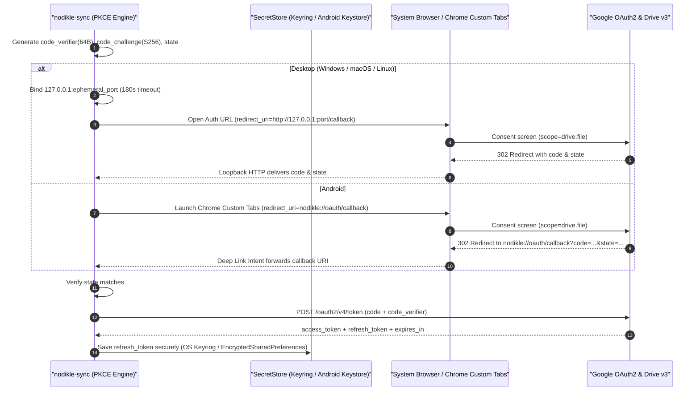

# 03. 확장 가능한 저장소 및 클라우드 동기화 아키텍처

## 1. Trait 기반 저장소·동기화 추상화

Nodikle는 1차 목표인 `Local Storage` + `Google Drive`를 넘어 향후 `Dropbox`, `iCloud`, `S3`, `WebDAV` 등 다양한 개인 클라우드 백엔드를 **코어 엔진 수정 없이** 추가할 수 있도록 `nodikle-storage`와 `nodikle-sync`에 명확한 Rust `trait` 경계를 정의합니다.

### 1.1 핵심 Trait 및 DTO 인터페이스 명세
```rust
// crates/nodikle-storage/src/traits.rs
#[derive(Debug, Clone)]
pub struct LocalFileMeta {
    pub rel_path: String,      // Vault 루트 기준 '/' 구분 정규화 경로
    pub size_bytes: u64,
    pub mtime_ms: i64,
    pub is_dir: bool,
}

#[async_trait::async_trait]
pub trait LocalFileStore: Send + Sync {
    async fn list_entries(&self, prefix: &str) -> Result<Vec<LocalFileMeta>, StorageError>;
    async fn stat(&self, rel_path: &str) -> Result<Option<LocalFileMeta>, StorageError>;
    async fn read_bytes(&self, rel_path: &str) -> Result<Vec<u8>, StorageError>;
    async fn write_atomic(
        &self,
        rel_path: &str,
        bytes: &[u8],
        expected_hash: Option<&str>,
    ) -> Result<String, StorageError>; // 반환값: 새 BLAKE3 해시
    async fn delete_entry(&self, rel_path: &str) -> Result<(), StorageError>;
    async fn rename_entry(&self, from: &str, to: &str) -> Result<(), StorageError>;
}

#[async_trait::async_trait]
pub trait SecretStore: Send + Sync {
    async fn get_secret(&self, key: &str) -> Result<Option<String>, StorageError>;
    async fn set_secret(&self, key: &str, value: &str) -> Result<(), StorageError>;
    async fn delete_secret(&self, key: &str) -> Result<(), StorageError>;
}
```

```rust
// crates/nodikle-sync/src/provider.rs
#[derive(Debug, Clone)]
pub struct RemoteFileMeta {
    pub remote_id: String,
    pub rel_path: String,
    pub rev: String,           // Google Drive version / ETag / S3 ETag
    pub content_hash: String,  // BLAKE3 또는 Provider 체크섬
    pub size_bytes: u64,
    pub modified_at_ms: i64,
}

#[derive(Debug, Clone)]
pub enum RemoteChange {
    Upsert(RemoteFileMeta),
    Delete { remote_id: String, rel_path: Option<String> },
}

#[derive(Debug, Clone)]
pub struct RemoteChangeSet {
    pub changes: Vec<RemoteChange>,
    pub next_cursor: String,
    pub has_more: bool,
}

#[async_trait::async_trait]
pub trait CloudStorageProvider: Send + Sync {
    fn provider_id(&self) -> &'static str; // "google_drive" | "dropbox" | "webdav" | "s3" | "icloud"

    async fn ensure_vault_root(&self, vault_name: &str) -> Result<String, SyncError>;
    async fn fetch_changes(&self, cursor: Option<&str>) -> Result<RemoteChangeSet, SyncError>;
    async fn download_file(&self, remote_id: &str) -> Result<Vec<u8>, SyncError>;
    async fn upload_file(
        &self,
        rel_path: &str,
        bytes: &[u8],
        content_hash: &str,
        expected_rev: Option<&str>,
    ) -> Result<RemoteFileMeta, SyncError>;
    async fn delete_file(&self, remote_id: &str, expected_rev: Option<&str>) -> Result<(), SyncError>;
}
```

### 1.2 향후 클라우드 프로바이더 확장 매트릭스
| 프로바이더 | 상태 | 변경 감지 메커니즘 | 인증 방식 |
|---|---|---|---|
| **Google Drive** | **MVP (1차)** | `changes.list` (`startPageToken`) | OAuth 2.0 PKCE (`drive.file`) |
| **Dropbox** | Phase 4 | `/files/list_folder/continue` 커서 | OAuth 2.0 PKCE |
| **WebDAV** | Phase 4 | `PROPFIND` Depth:1 + `ETag`/`getlastmodified` | Basic / Digest / OAuth2 Bearer |
| **S3 호환** | Phase 4 | `ListObjectsV2` + `ETag` 메타데이터 | Access Key / STS 임시 자격 증명 |
| **iCloud Drive** | Phase 4 | `NSFileCoordinator` / `NSMetadataQuery` | Apple 시스템 계정 연동 |

---

## 2. MVP 1: Local Storage 상세 설계 (Desktop vs Android)

### 2.1 경로 정규화 및 보안 경계
- 모든 Vault 내부 경로는 OS와 무관하게 `/` 구분자를 사용하는 상대 경로(`finance/2026-11-27-lunch.md`)로 정규화합니다.
- `nodikle-storage::atomic` 계층에서 `..` 세그먼트, 절대 경로, 심볼릭 링크를 통한 Vault 루트 탈출(Path Traversal)을 거부합니다(`ERR_INVALID_PATH`).
- **인덱스·임시 파일 무시 목록:** `.nodikle/index.db*`, `.git/`, `*.tmp`, `.DS_Store`, `Thumbs.db`는 로컬 인덱서와 클라우드 동기화 대상에서 자동 제외합니다.

### 2.2 Desktop (`Windows` / `macOS` / `Linux`)
- `DesktopFsStore`: `std::fs` / `tokio::fs` 기반으로 사용자가 지정한 로컬 Vault 폴더를 직접 관리합니다.
- `notify` 크레이트를 통해 파일 생성·수정·삭제·이동 이벤트를 수신하고 150ms 디바운스 후 증분 인덱싱을 실행합니다.
- 외부 텍스트 편집기에서 동일 Vault를 함께 편집해도 안전하도록 파일 락을 오래 점유하지 않고 쓰기 시점에만 원자적 `rename`을 사용합니다.

### 2.3 Android Scoped Storage 대응 전략
Android 11(API 30)+에서는 공용 저장소에 대한 직접 `std::fs` 접근이 제한되므로, **2가지 로컬 저장소 모드**와 **SQLite 위치 분리 규칙**을 적용합니다.

| 구분 | 모드 A: 앱 전용 저장소 (기본 권장) | 모드 B: Android SAF (`ACTION_OPEN_DOCUMENT_TREE`) |
|---|---|---|
| **저장 위치** | `context.filesDir/vaults/<vault_id>` | 사용자가 선택한 기기 공용 폴더 / SD카드 |
| **구현 어댑터** | `DesktopFsStore`와 동일한 Rust `std::fs` 직접 접근 | `AndroidSafStore` → Tauri Android Plugin(Kotlin `ContentResolver`) |
| **I/O 성능 & 안정성** | **최상** (JNI 브릿지 오버헤드 없음, 대량 스캔 고속) | 보통 (`DocumentFile` 트리 순회 비용 존재, 대량 파일 시 캐시 필요) |
| **주의 사항** | Android Auto Backup(`allowBackup`)에서 Vault/DB를 제외해 클라우드 이중 동기화 충돌 방지 | `takePersistableUriPermission` 영속 권한 유지 필요, 권한 회수 시 `ERR_STORAGE_PERMISSION` 안내 |

**Kotlin SAF 플러그인 브릿지 계약 (모드 B 전용):**
- `listTree(treeUri, prefix)` → `Vec<LocalFileMeta>` (하위 경로 및 `LAST_MODIFIED`, `SIZE` 일괄 조회)
- `readBytes(treeUri, relPath)` / `writeAtomic(treeUri, relPath, bytes)` (임시 문서 생성 후 교체 또는 스트리밍 쓰기)
- **공통 불변 규칙:** 모드 A/B와 무관하게 **SQLite 인덱스(`.db`) 및 `sync_state`는 항상 앱 내부 전용 저장소(`filesDir/db/<vault_id>.db`)**에 저장합니다. Android SAF 경로 위에서는 POSIX 파일 잠금과 SQLite WAL 저널링이 보장되지 않기 때문입니다.

---

## 3. MVP 2: Google Drive 동기화 및 OAuth 2.0 (PKCE)

### 3.1 크로스플랫폼 OAuth 2.0 PKCE (`S256`) 인증 흐름
네이티브 앱은 `client_secret`을 기밀로 보관할 수 없으므로 **RFC 7636 PKCE (`S256`)**와 `state` CSRF 검증을 필수 적용합니다.



- **Single-Flight 토큰 리프레시:** 여러 백그라운드 업로드/다운로드 요청이 동시에 `401 Unauthorized`를 받더라도 `tokio::sync::Mutex` 기반 단일 리프레시 락으로 `refresh_token` 교환 요청을 1회만 수행해 토큰 회전(Rotation) 경합을 방지합니다.

### 3.2 Google Drive API v3 매핑 및 첨부 파일 지연 캐싱
- **최소 권한 스코프:** `https://www.googleapis.com/auth/drive.file`만 요청해 앱이 생성·관리하는 전용 루트 폴더(`NodikleVault/`) 내부만 접근합니다.
- **메타데이터 매핑:** 각 Drive 파일의 `appProperties`에 `nodikle_path`와 `blake3`를 저장해 파일 다운로드 전에도 해시 비교가 가능하도록 합니다.
- **대용량 첨부 파일 전송:**
  - `<= 5 MB`: Multipart Upload
  - `> 5 MB`: Google Drive Resumable Upload 세션(청크 단위 재개 가능)
- **모바일 첨부 파일 지연 다운로드 (On-Demand Lazy Cache):**
  - `.md` 및 `.nodikle/views/*.yaml` 텍스트 파일은 동기화 시 즉시 내려받습니다.
  - 이미지·PDF 등 첨부 파일(`attachments/`)은 메타데이터만 인덱싱하고, 사용자가 해당 문서를 열거나 임베드 뷰가 요청할 때 다운로드합니다.
  - 모바일 캐시 용량 상한(기본 `500 MB`) 초과 시 최근 접근 시각 기준 LRU 방식으로 로컬 캐시만 제거하며 원격/메타데이터는 유지합니다.

---

## 4. 동기화 상태 DB & 3-Way 병합/충돌 엔진

### 4.1 로컬 동기화 메타데이터 DDL (`filesDir/db/<vault_id>.db`)
```sql
CREATE TABLE IF NOT EXISTS sync_meta (
    key   TEXT PRIMARY KEY,               -- 'sync_cursor', 'remote_root_id', 'device_id'
    value TEXT NOT NULL
);

CREATE TABLE IF NOT EXISTS sync_state (
    rel_path         TEXT PRIMARY KEY,
    remote_id        TEXT,
    last_synced_hash TEXT,                -- Base BLAKE3 hash
    last_synced_rev  TEXT,                -- Base remote rev
    is_deleted_base  INTEGER NOT NULL DEFAULT 0,
    cache_state      TEXT NOT NULL DEFAULT 'synced', -- synced|not_downloaded|evicted
    last_accessed_ms INTEGER NOT NULL DEFAULT 0
);

CREATE TABLE IF NOT EXISTS sync_queue (
    id            INTEGER PRIMARY KEY AUTOINCREMENT,
    rel_path      TEXT NOT NULL UNIQUE,
    op            TEXT NOT NULL,          -- upsert|delete|rename
    retry_count   INTEGER NOT NULL DEFAULT 0,
    next_retry_ms INTEGER NOT NULL DEFAULT 0,
    last_error    TEXT
);

CREATE TABLE IF NOT EXISTS sync_conflicts (
    id            TEXT PRIMARY KEY,
    original_path TEXT NOT NULL,
    conflict_path TEXT NOT NULL,
    detected_at   TEXT NOT NULL,
    status        TEXT NOT NULL DEFAULT 'open' -- open|resolved
);
```

### 4.2 확장 3-Way 변경 감지 판정 매트릭스 (생성·수정·삭제 포함)
| 로컬 상태 (`local` vs `base`) | 원격 상태 (`remote` vs `base`) | 판정 | 실행 동작 |
|---|---|---|---|
| 변경 없음 | 변경 없음 | **No-op** | 생략 |
| 수정 / 신규 생성 | 변경 없음 | **Push Upsert** | 원격 업로드(`expected_rev` 체크) 후 `base` 갱신 |
| 로컬 삭제 | 변경 없음 | **Push Delete** | 원격 삭제 후 `sync_state` 정리 |
| 변경 없음 | 수정 / 신규 생성 | **Pull Upsert** | 원격 다운로드 후 원자적 교체 및 SQLite 재인덱싱 |
| 변경 없음 | 원격 삭제 | **Pull Delete** | 로컬 파일 삭제(휴지통/내부 아카이브 이동) 및 인덱스 제거 |
| 수정 / 신규 생성 | 수정 / 신규 생성 (`hash` 동일) | **Converged** | 내용 동일하므로 `base` 해시·리비전만 최신화 |
| 수정 / 신규 생성 | 수정 / 신규 생성 (`hash` 상이) | **Conflict** | 무손실 충돌 복사본 생성 |
| 수정 | 원격 삭제 | **Conflict (Delete/Edit)** | 로컬 편집 손실 방지를 위해 로컬본을 `.conflict-*`로 보존 + 원격 상태 안내 |
| 로컬 삭제 | 원격 수정 | **Conflict (Edit/Delete)** | 원격 최신본을 재다운로드해 데이터 유실 차단 |

### 4.3 무손실 충돌 복사본 및 해소 흐름
1. 충돌 감지 시 원격 최신본을 원래 경로(`notes/meeting.md`)에 반영하고, 로컬 수정본은 같은 폴더에 아래 패턴으로 저장합니다:
   `<stem>.conflict-<device_id>-<YYYYMMDD-HHmmss>.md`
   (예: `notes/meeting.conflict-pixel9-20261127-201500.md`)
2. `sync_conflicts` 테이블에 기록하고 `sync:conflict_detected` 이벤트를 발행합니다.
3. 사용자는 UI의 라인 단위 Diff 비교 화면에서 **① 원격본 유지**, **② 충돌본으로 덮어쓰기**, **③ 양쪽 모두 별도 문서로 보관** 중 하나를 선택해 해소합니다.

---

## 5. 모바일 배터리·네트워크 동기화 스케줄러 정책

| 조건 / 트리거 | 동작 정책 | 구현 세부 사항 |
|---|---|---|
| **편집 디바운스 Push** | 마지막 저장 후 `3~5초` 유휴 시 실행 | 연속 타이핑 중 불필요한 업로드 요청 병합 |
| **포그라운드 복귀 Pull** | 앱 활성화 시 실행 (`30초` 최소 쿨다운) | `changes.list` 델타 Pull만 즉시 수행 |
| **Metered(셀룰러) 네트워크** | Android `ConnectivityManager`가 종량제 감지 시 | `.md` 텍스트와 뷰 YAML만 우선 동기화, `> 2 MB` 첨부 파일은 Wi-Fi 연결까지 보류(사용자 옵션) |
| **백그라운드 주기 동기화** | Android `WorkManager` (`PeriodicWorkRequest`, 15~60분) | 제약 조건: `NetworkType.CONNECTED` + `setRequiresBatteryNotLow(true)` |
| **오류 및 Rate Limit 대응** | HTTP `429`/`503` 또는 일시 네트워크 단절 시 | `Retry-After` 헤더 우선 준수, 없을 경우 지수 백오프(`30s -> 2m -> 10m -> 30m`) + ±20% Jitter |
