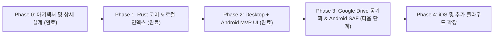

# 04. 단계별 구현 로드맵 및 검증 기준

Nodikle는 **플랫폼 독립 Rust 코어 엔진을 단위 테스트로 먼저 완성**한 뒤, **Desktop + Android MVP UI**, **Google Drive 양방향 동기화**, **플랫폼·클라우드 확장** 순서로 단계별 구현합니다.

---

## 전체 마일스톤 흐름

---

## Phase 0. 아키텍처 및 상세 설계 (완료)
- **목표:** 프로젝트 방향성, 크로스플랫폼 UI 전략, 하이브리드 데이터 모델, Trait 기반 저장소/동기화 아키텍처 확정.
- **산출물:**
  - `README.md`, `CONTRIBUTING.md`, `CHANGELOG.md`, `.gitignore`, Issue/PR 템플릿
  - [01. 전체 시스템 아키텍처 및 크로스플랫폼 UI 전략](01-architecture.md)
  - [02. 하이브리드 문서·데이터 모델 및 데이터베이스 뷰 설계](02-data-model-and-views.md)
  - [03. 확장 가능한 저장소 및 클라우드 동기화 아키텍처](03-storage-and-sync.md)
  - [04. 단계별 구현 로드맵 및 검증 기준](04-roadmap.md)

---

## Phase 1. 플랫폼 독립 Rust 코어 & SQLite 인덱스 엔진 (완료)
- **목표:** UI 없이도 동작하며 자동화된 테스트로 완전히 검증되는 코어 라이브러리 구축.
- **구현 대상 크레이트:** `nodikle-model`, `nodikle-core`, `nodikle-index`, `nodikle-storage` (Desktop 어댑터 포함).
- **세부 작업:**
  1. Cargo Workspace 구성 및 GitHub Actions PR CI(`.github/workflows/ci.yml`: `cargo fmt --check`, `cargo clippy`, `cargo test --workspace`) 구축.
  2. `nodikle-core`: Markdown 파서, 본문/주석 보존형 Frontmatter Round-Trip 업데이터, `[[wikilink]]`/중첩 태그/체크리스트 추출기, 템플릿 변수 치환기 구현.
  3. `nodikle-index`: SQLite WAL 스키마 마이그레이션, FTS5(`trigram`) + 초단문 `LIKE` 폴백 검색, 증분 스캐너(`mtime` + `BLAKE3`), Filter AST 및 집계(`SUM`, `AVG`, `COUNT`, `checked_ratio`) SQL 빌더 구현.
  4. `nodikle-storage`: `LocalFileStore`/`SecretStore` 트레이트 및 Path Traversal 차단·원자적 쓰기(`write_atomic`) 구현.
- **필수 단위·통합 테스트 & 완료 기준 (DoD):**
  - Frontmatter Round-Trip 테스트(기존 주석·미등록 키·한글 본문 100% 보존 검증).
  - 코드 블록 내부 `[[링크]]`/`#태그` 무시 및 미생성 링크 역참조 테스트.
  - 가계부 1,000건 샘플 기준 월별/카테고리별 `SUM` 집계 및 한글 1~3글자 검색 정확도·성능(`10,000`건 스캔 `< 300 ms`) 벤치마크 통과.

---

## Phase 2. Desktop + Android MVP 애플리케이션 (완료)
- **목표:** Tauri v2 단일 UI 코드베이스로 Desktop과 Android에서 로컬 Vault를 생성하고 노트·가계부·여행 플래너를 실사용할 수 있는 MVP 완성.
- **구현 대상:** `apps/app` (Tauri v2 호스트), `frontend/` (React + TypeScript + TipTap + CodeMirror 6).
- **세부 작업:**
  1. Tauri v2 IPC 커맨드/이벤트 바인딩 및 Desktop `notify` 파일 워처(자체 쓰기 에코 억제 포함) 연동.
  2. 하이브리드 에디터 구현(블록 편집 모드 ↔ 원문 Markdown 모드 전환, `[[` 위키링크·`#` 태그 자동완성, 백링크 패널).
  3. 데이터베이스 뷰 3종 구현: **테이블**(그룹화 + 집계 행), **칸반 보드**(드래그 상태 전환), **캘린더**(날짜별 금액/일정 배지).
  4. 기본 내장 템플릿 번들(**가계부**, **여행 플래너**) 및 템플릿 기반 문서 생성 플로우 구현.
  5. 모바일 반응형 UX 구현: `< 640px` 카드 뷰 자동 전환, 상태 세그먼트 탭, 하단 FAB **퀵 입력 바텀 시트**, 하단 고정 요약 바.
- **완료 기준 (DoD):**
  - Windows/macOS/Linux 데스크톱 및 Android 실기기/에뮬레이터에서 로컬 Vault 생성 → 가계부 퀵 입력 → 월별 합계 확인 → 여행 체크리스트 토글 → `.md` 파일 원본 반영 E2E 검증 통과.

---

## Phase 3. Google Drive 양방향 동기화 & Android SAF 지원
- **목표:** 오프라인 우선 편집을 유지하면서 Desktop ↔ Google Drive ↔ Android 간 안전한 양방향 동기화 및 Android 외부 폴더 옵션 제공.
- **구현 대상:** `nodikle-sync`, Android Kotlin 플러그인(Custom Tabs Deep Link, Keystore, `WorkManager`, SAF 브릿지).
- **세부 작업:**
  1. `CloudStorageProvider` 트레이트 기반 `GoogleDriveProvider` (`drive.file`, `changes.list`, Resumable Upload) 구현.
  2. OAuth 2.0 PKCE (`S256`) 인증 구현 (Desktop 루프백 서버 + Android Chrome Custom Tabs Deep Link) 및 `SecretStore` 연동.
  3. 3-Way 변경 감지 엔진, 오프라인 `sync_queue`, 무손실 `.conflict-<device>-<ts>.md` 생성 및 UI Diff 병합 모달 구현.
  4. 모바일 첨부 파일 지연 다운로드 캐시(500MB LRU), Metered 네트워크 필터, `WorkManager` 백그라운드 주기 동기화 적용.
  5. Android SAF(`ACTION_OPEN_DOCUMENT_TREE`) 브릿지 플러그인 및 GitHub Release CD 워크플로우 구축.
- **필수 테스트 & 완료 기준 (DoD):**
  - Mock `CloudStorageProvider`를 이용한 3-Way 판정 매트릭스(수정/삭제/동시편집/재연결) 전수 단위 테스트 통과.
  - Desktop과 Android에서 오프라인 상태에서 동일 문서 동시 수정 후 온라인 복귀 시 무손실 충돌 복사본 생성 및 Diff 병합 검증.

---

## Phase 4. 플랫폼 및 클라우드 스토리지 생태계 확장
- **목표:** iOS 지원 추가 및 다양한 개인 클라우드/NAS 백엔드 확장.
- **세부 작업:**
  1. iOS 어댑터(`ASWebAuthenticationSession`, iOS Keychain, `UIDocumentPickerViewController`, `BGAppRefreshTask`) 구현 및 iOS 타깃 빌드 검증.
  2. 추가 `CloudStorageProvider` 구현: **WebDAV** (범용 개인 NAS 서버 연동), **S3 호환 스토리지**, **Dropbox**, **iCloud Drive**.
  3. 지식 그래프(Graph View) 시각화 및 문서 간 관계형(`relation` / `rollup`) 집계 기능 고도화.

---

## CI/CD 및 릴리즈 전략 (Phase 1+ 도입 예정)
- **PR CI:** `master` 대상 Pull Request 생성/갱신 시 `cargo fmt --all -- --check`, `cargo clippy --workspace --all-targets`, `cargo test --workspace`, `npm --prefix frontend run build` 자동 실행.
- **Release CD:** 버전 태그(`v*`) 푸시 시 플랫폼별 배포 아카이브를 자동 빌드해 GitHub Releases Assets에 업로드:
  - **Windows:** `.zip`
  - **macOS:** `.tar.gz` 또는 `.zip`
  - **Linux:** `.tar.gz`
  - **Android:** `.apk` / `.aab`
